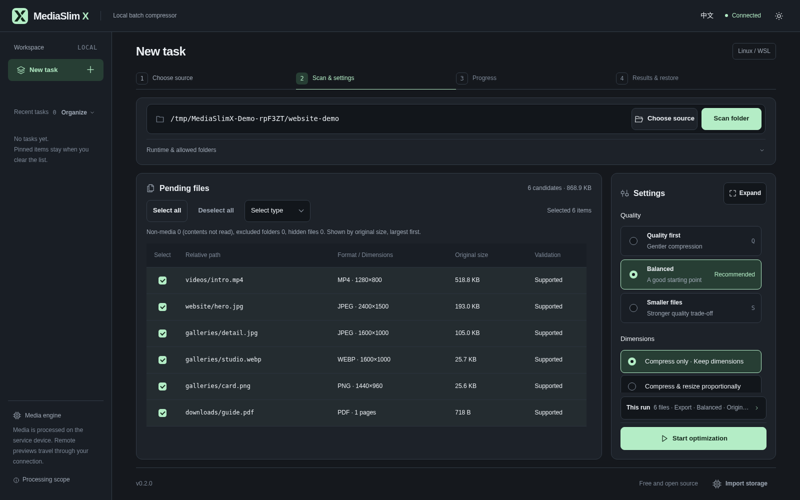

# MediaSlim X

[简体中文](README.md) | English


MediaSlim X is a free, open-source local batch compression tool. Scan a folder, select images, MP4 videos or PDFs, and inspect what actually happened to each file. By default, it exports to a new directory while keeping originals, filenames and relative folder structure.

**Source code is the only public download for now.** The Windows standalone window and Linux/WSL browser interface can run from source, but there is no ready-to-run Windows portable package or other binary download. GitHub's **Download ZIP** contains source and requires the environment below. Portable distribution is waiting on dependency licensing materials and clean-Windows acceptance.

## What it does

- Scan folders on the device running the service; select files individually or by type. Files can also be dropped into the workbench. The Windows standalone window can scan a single local folder dropped onto it.
- Choose quality-first, balanced or smaller-file presets. Images and supported MP4 videos can optionally be **scaled down proportionally** within maximum dimensions; original dimensions are the default. PDF page dimensions and image quality are not changed.
- Export by default and keep originals. To update original paths, explicitly choose backup-and-replace. Direct replacement without a backup requires extra confirmation and is unavailable for PDFs.
- Show real progress, no-gain and skip reasons; retain task history, previews, CSV reports and conflict-aware restoration when a backup exists. Savings depend on the actual files and are never promised in advance.



## Supported files

| Type | Current scope |
| --- | --- |
| Images | JPG/JPEG, PNG and static WebP. Animated images and some unusual color formats are skipped. |
| Video | Ordinary H.264, 8-bit SDR `yuv420p` MP4 with at most one AAC audio track; requires FFmpeg and ffprobe. HDR, rotation, subtitles and complex streams are skipped. |
| PDF | **Optional** pikepdf support for eligible unencrypted static PDFs. It recompresses structure and eligible data without changing page dimensions. Encrypted, signed, form-based or annotated PDFs are unsupported. |

See the [v1 specification](docs/v1-spec.md) for exact limits and skip reasons. Image and video processing can be lossy; unsupported or failed files are kept or skipped, never reported as successful output.

## Run from source

### Windows: standalone window

1. Install **Python 3.10+** (including Tcl/Tk) and **Microsoft WebView2 Evergreen Runtime**. Building the window helper also needs the Windows .NET Framework C# compiler. MP4 processing needs Windows FFmpeg and ffprobe on `PATH`.
2. Clone the repository or download and fully extract the source ZIP.
3. Double-click **`Start-MediaSlimX.vbs`** in the project folder. The first launch creates a Windows-only virtual environment and installs Python dependencies; preparing the window component may download the WebView2 SDK. Later launches open the window directly. If preparation fails, run **`Start-MediaSlimX.cmd`** to see the error.

For the browser interface instead, run **`Start-MediaSlimX-Browser.cmd`**. It uses the same processing core but keeps its own task history. Do not open `mediaslimx/static/index.html` directly: the interface needs the local service.

### Linux / WSL: browser interface

Install **Python 3.10+** and, for MP4, FFmpeg and ffprobe for this platform. From the project directory run:

```bash
./start-wsl.sh
```

The first launch creates a separate Linux/WSL `.venv` and installs pinned dependencies. Open the **complete local URL** printed in the terminal. To scan media outside the project directory, add `--allow-root /absolute/media/path`. On a server, keep the service bound to loopback and use an SSH tunnel, for example:

```bash
ssh -N -L 8765:127.0.0.1:8765 user@server
```

Windows and WSL do not share virtual environments, paths or task data. A Windows path such as `D:\...` cannot be pasted into the WSL service.

### Optional PDF support

The base requirements do not include pikepdf. After the first source launch, install it into the environment for the platform you are using, then restart the tool:

```bash
# Linux / WSL
.venv/bin/python -m pip install -r requirements-pdf.txt
```

On Windows, run in the project folder:

```powershell
.\.venv-win\Scripts\python.exe -m pip install -r requirements-pdf.txt
```

Without this dependency, images and videos still work; PDFs show an actionable skip reason.

## Workflow and data boundaries

1. Choose or scan a folder and select candidates. Scanning alone does not start compression.
2. Set a preset, optional dimensions and output mode. Review where originals, results and backups will go before starting.
3. Inspect each result, preview and report. Restore from backups where available; later edits to a processed file cause restoration to skip that conflict.

Folder scans read candidate media only inside the selected scope. They do not follow symlinks and skip hidden, dependency, output and backup directories. Dropping files or folders through the browser sends **copies to the MediaSlim X service you are connected to**, so browser imports are export-only. When connected to a remote service, those copies go to that server. Browser imports are limited to 200 media files and 2 GiB per batch; scan a folder on the service device for larger sets.

The tool does not upload media to third parties or use accounts, telemetry or external CDNs. Remote previews still travel over the connection you establish to the browser. The service binds to `127.0.0.1` by default; do not expose it directly to the public internet. See [privacy and security](docs/privacy-security.md).

## Validation, docs and license

The Windows source window and WSL/Linux core have been tested with synthetic media. A separate Linux server, macOS and physical phones have not been fully verified. Demo savings come only from synthetic files, not a real website. See [platform status](docs/platforms.md) and the [release guide](docs/release-guide.md).

Run Python tests:

```bash
.venv/bin/python -m unittest discover -s tests
```

On Windows use `.venv-win\Scripts\python.exe -m unittest discover -s tests`. Licensed under the [MIT License](LICENSE); all core features are free. When reporting issues, remove tokens, private paths and sensitive media from logs and screenshots.
