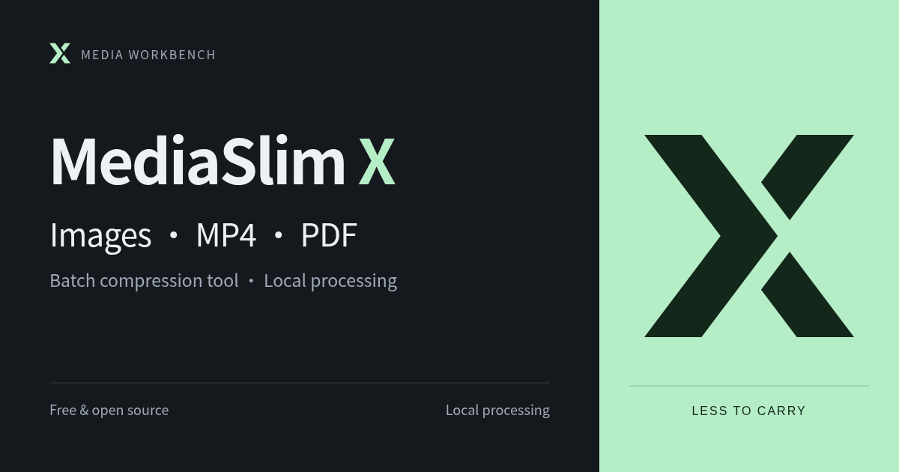

# MediaSlim X

[简体中文](README.md) | English

A free, open-source local batch optimizer for website images, supported ordinary MP4 videos, and unencrypted ordinary PDFs. It handles JPG, PNG, and static WebP images; video and PDF support has defined limits, and savings vary by file. One Python core and a Chinese/English workbench: a standalone window on Windows, and a browser interface on Linux/servers. MIT licensed.

**Source code only is public for now.** Install the dependencies below to run from a Windows or Linux/WSL checkout. GitHub's source ZIP is not a ready-to-run Windows portable app. The portable build and all other binary downloads remain on hold for licensing materials and clean-Windows acceptance; this publication has no downloadable Release assets.

Scan an allowed folder on the service device, or explicitly import files and folders from your browser. Batch optimization, export, backup-and-replace, inspection, persistent history, and conflict-aware restoration are included. The service binds to **127.0.0.1** by default.

In the Windows standalone window, **Choose a local folder** opens the system picker and scans in place, without creating import copies or triggering the browser's folder-upload prompt. In a browser or remote session, **Import folder copies** transfers selected files to the current service (the browser may ask for confirmation); **Scan a folder on this service** reads a folder on the service device instead. Scanning only prepares the list; optimization still requires Start.

## Windows: standalone portable window (local candidate)

A Windows x64 window build hosts the existing workbench and Python core, bundling Python, the image/PDF engines, FFmpeg and ffprobe. Extract the complete window bundle and double-click **MediaSlimX.exe** to open its own window, without launching an external browser. An installed **Microsoft WebView2 Evergreen Runtime** is required. The full Runtime is not bundled; missing support produces manual installation instructions, without an automatic download or silent browser fallback. See [Windows standalone window](docs/windows-window.md).

The current artifact is a **local validation candidate**, with no public download or release. The latest window build uses official CPython 3.13.16 materials and a minimal FFmpeg/ffprobe engine built from pinned sources. Exact provenance and LGPL relinking materials for lxml's static iconv, plus real clean-Windows acceptance, remain release blockers. Sandbox has been enabled on the acceptance host, but Windows requires a manual restart before use; it is a development test environment, not a portable-app dependency. See [packaging, size, and data isolation](docs/packaging.md). Source-based startup follows below.

The portable build includes its media environment: no first-launch Python installation, pip command or engine download. Offline window startup requires WebView2 Runtime to be installed beforehand. The old prototype was about 197 MiB, mostly general-purpose FFmpeg binaries. **The latest standalone-window validation candidate is a 36.36 MiB ZIP**; it is not a public download. Corresponding third-party sources remain a separate companion archive, unnecessary for ordinary use.

## Windows source checkout

For everyday use, double-click **Start-MediaSlimX.vbs** in the project folder. It hides the source preparation console and opens the standalone window. If preparation fails, it directs you to **Start-MediaSlimX.cmd** for the detailed console error. Pin a shortcut to the `.vbs` file, not the display-only `MediaSlimX.Window.exe`.

- Install Windows Python 3.10+ first, including Tcl/Tk for the native folder picker.
- The launcher locates its own project folder, including names with spaces or Chinese characters.
- It creates **.venv-win** and installs requirements-lock.txt when needed. Initial window preparation may also fetch the pinned WebView2 SDK and build its helper with the Windows .NET Framework C# compiler. The SDK is not the Runtime.
- It uses Windows `pythonw.exe`, selects an available loopback port in **8767–8866**, and stores source-window data in **.mediaslimx/windows-window**. A second launch attempts to activate the verified existing window and never adopts another browser service.
- The native window shows a compact bilingual graphite-and-mint startup cover with the actual core version only while the local workbench is initializing, then enters as soon as it is ready. Its short activity line and faint moving mint light along the bottom do not represent a completion percentage. Errors appear on the same cover with Retry or Exit; service failures before the window exists use a Windows Retry/Cancel prompt. The portable bundle already contains Python and media libraries, and this cover does not imply an online installation or update check. The source launcher rebuilds its native helper on the next fresh launch after a source change; an already-running window can still be activated. See [Windows startup states and real screenshots](docs/startup-window.md). Existing portable validation bundles do not yet include this change.
- Idle close exits directly. Busy close opens a same-theme, single-language dialog with Keep processing focused by default; Escape, its X and Keep processing preserve the running work. Save progress and quit stops the remaining queue and drains owned transactions, helpers and service. Completed results, remaining-file records and backups are kept. On the next launch, processing starts only after you choose Continue remaining files. The window-only Quit tool footer action follows the same path; browser/server mode has no such action. Current source, r10 and later local candidates contain this flow; the older r7 ZIP does not.
- Windows FFmpeg and ffprobe must be available in the **Windows PATH**. WSL tools are a separate installation.
- An interpreter can be selected with MEDIASLIMX_PYTHON. To choose a port, use `Start-MediaSlimX.cmd -Port 8768` or add `-Port 8768` to the quiet shortcut. Add `-DataDir "full Windows path"` to keep using an existing task database; changing it does not move records.
- **Start-MediaSlimX-Browser.cmd** preserves the browser workflow at port **8766** with **.mediaslimx/windows**, including `-NoBrowser`. Keep that entry's console open and stop it with Ctrl+C; closing its browser does not stop the service.
- Do not open `mediaslimx/static/index.html` directly as a `file://` page. Its `/static/` assets and authenticated API require the local server. Start the browser launcher and use the complete `http://127.0.0.1:port/#token=...` URL it provides. Browser and standalone-window modes share the interface and processing core, but keep separate task data.

The web interface can browse allowed folders without scanning at each navigation step. Confirming **Scan this folder** starts a read-only candidate scan immediately; manually entered paths and rescans still use the main Scan folder button. Optimization always requires a separate Start action. Output and backup folder pickers only fill their paths. Windows desktop mode also provides a system folder picker; a newly chosen folder is authorized only after actual selection.

## Start on Linux / WSL

~~~bash
./start-wsl.sh
~~~

The script uses Linux Python 3.10+, the project's **.venv**, port **8765**, and **.mediaslimx/wsl**. It creates the environment and installs locked dependencies if needed. Open the full URL printed in the terminal, including its access token. Use --open-browser on a Linux desktop if desired.

Manual setup:

~~~bash
python3 -m venv .venv
.venv/bin/python -m pip install -r requirements-lock.txt
.venv/bin/python -m mediaslimx --allow-root /absolute/media/path
~~~

Install FFmpeg with your Linux package manager. Pillow handles images; FastAPI and Uvicorn serve the interface. There is no Redis, Celery, account system, or Node.js requirement.

Exports keep originals in place and create a separate, dated task folder beneath the selected output root (for example, `2026-10-18_15-30-00-a1b2c3d4`). This prevents one export from overwriting another. Existing tasks keep their original full-ID folder names. In the Windows window, an **Open** action beside each available folder opens that recorded location.

For a server, use an SSH tunnel and keep the same local and remote port:

~~~bash
ssh -N -L 8765:127.0.0.1:8765 user@server
~~~

Do not expose the service directly to the public internet.

## Keep Windows and WSL separate

| Setting | Windows window | Windows browser entry | Linux / WSL |
| --- | --- | --- | --- |
| Python environment | .venv-win | .venv-win | .venv |
| Launcher port | Available port in 8767–8866 | 8766 | 8765 |
| Runtime data | .mediaslimx/windows-window | .mediaslimx/windows | .mediaslimx/wsl |
| Example source path | D:\media | D:\media | /mnt/d/media |
| Video tools | Windows FFmpeg/ffprobe | Windows FFmpeg/ffprobe | Linux FFmpeg/ffprobe |
| Default import exports | .mediaslimx/exports-windows-window | .mediaslimx/exports-windows | .mediaslimx/exports-wsl |

Windows and WSL use different Python environments. Both Windows source entries share `.venv-win`, but source-window, source-browser and WSL databases, import copies and output defaults are separate; preview cookies are scoped by port. Paths are validated for the current platform and are not automatically converted. Do not open one platform's task database using the other platform's interpreter, or let separate instances replace the same source files concurrently.

## Workflow

1. Choose an allowed folder on the service device and scan it, or drop browser files/folders onto the page. File and folder picker buttons are also available. Source double-click launchers allow the project folder; server CLI defaults to its working directory. The portable window starts in the user's Pictures folder, or the EXE folder if Pictures is absent. Use the Windows system picker to authorize another folder, or set CLI `--allow-root` explicitly.
2. Inspect actual candidates, sizes, unsupported formats, and validation errors. Select supported entries.
3. Choose **Quality first**, **Balanced** (default), or **Smaller files**. Dimensions stay unchanged unless proportional downsizing is explicitly selected. There is no cropping, stretching, or upscaling.
4. Choose the output behavior. Imports are always export-only. Folder scans also support backup-and-replace or explicitly confirmed replacement without backup.
5. Inspect real progress and results, preview images or play videos, export relative-path CSV reports, or download an import task's export ZIP.
6. Restore one or all backed-up files. Changed results are skipped as conflicts; existing work is not silently overwritten.

Use **EN / 中文** in the top bar to switch language without losing the pending list, selection, settings, or current transfer. Chinese is the default. Language and theme preferences stay in the current window profile or browser. Paths, filenames, media metadata, stored task values, and CSV status codes are not translated. CSV reason text remains as stored, and OS diagnostics may remain in the operating system's language.

Recent tasks show the source name above its status and parent path. On an eligible row, Archive and Pin appear together on hover or keyboard focus, with matching quiet icon styles and 44px targets. Touch devices keep the actions visible; pinned icons remain visible. The **Organize** menu opens on hover or click and contains **Archive unpinned** and **Archived N**. Archiving only hides records; it does not delete media, results, backups, or permissions. Archived entries can be returned to the list.

Use **Expand** beside the settings heading to edit the same form in a wider overlay. Open the **This run** summary above Start to review quality, dimensions, originals, output/backup paths, and recovery. Reviewing creates no task. Result filenames, extensions, and relative folders are preserved; batch renaming is not available in this version.

## Folder imports

In the Windows standalone window, **dropping one real local folder scans that folder directly**. It prepares export mode and keeps originals, avoiding a second folder selection after an import limit. Scanning inspects candidate media without optimizing or replacing them; select files and press **Start** to process. Hidden, dependency, runtime-data, output and backup directories remain excluded, including default `mediaslimx-export` / `mediaslimx-backup` names before any task registers them.

The native drop shortcut applies only to one folder dropped into the standalone window; its empty-state **Choose a local folder** action separately uses the controlled system picker to scan in place. Loose files, multiple folders, ordinary browsers/remote sessions using **Import folder copies**, and **Add folder copies** on an existing import still use copy-based imports and the 200-file / 2 GiB limit. A browser FileList has no reliable root-directory object, so the app does not infer a parent path from child files.

Copy-based folder imports retain the top-level name and relative structure:

~~~text
Assets/images/cover.jpg
Assets/video/demo.mp4
~~~

Exported files and ZIP members use the same paths. Identical filenames in different folders remain separate; duplicates at the same relative path receive numbers such as cover (2).jpg. Directory casing is made consistent for Windows compatibility. Empty folders and non-media files are not copied.

Before transfer, the collector skips dot-prefixed entries, dependency/build/cache folders, conventional output/backup names, and the basenames of output/backup folders already registered with this instance. The server independently validates relative paths and exclusions. Because browser APIs expose relative names rather than original absolute paths, registered names are excluded conservatively wherever they occur.

Limits: **200 media files**, **1 GiB per image/video** or **64 MiB per PDF**, **2 GiB per batch**, **20 directory levels**, **20000 enumerated entries**, and **1024 UTF-8 bytes per relative path**. The instance's total declared import capacity is **8 GiB**, including source copies referenced by history. Use direct folder scanning for larger sets. There is no resumable upload.

The empty-state entry always shows the **200-file / 2 GiB** import limit. For file-count, directory-entry or depth limits, the panel compares the discovered value with its limit. A batch-capacity warning states the **2 GiB** ceiling without an exact discovered byte total. It reports **zero newly transferred files**, never silently keeping the first 200 items. Your existing list, checked selection, output path and mode remain unchanged. Choose folder scanning on the service device for larger sets: only a successful scan switches the source and prepares the default export mode. Cancelling the picker or a failed scan keeps the previous import. Scanning only prepares a pending list; optimization still requires **Start**.

An **8 GiB import-storage quota** shortage is shown separately, with an entry to **Import storage** for manual review and confirmed cleanup. No copies are automatically deleted. Switching successfully to folder scanning also leaves old import copies in their separate storage; release them explicitly when they are no longer needed.

Browser folder APIs do not expose all native hidden attributes or link metadata. For strict native filesystem filtering, use **folder scanning** on the service device. The browser import does not infer or authorize an original absolute filesystem path. See the detailed [privacy and boundary notes](docs/privacy-security.md).

## Output and retention

- **Export** is the default: output-root/task-id/relative-path. Originals remain in place.
- **Back up & replace** first copies originals into backup-root/task-id/relative-path, then atomically replaces successfully verified, smaller results.
- **Replace without backup** requires explicit confirmation. Original comparison and restoration cannot be offered if no original remains.
- The result page initially shows the output mode and a shortened result path. Expand **Folder details** to read the full source, result, and applicable backup folders with explanations. In the Windows standalone window, **Open** beside an available folder opens that recorded location. Server-browser use displays paths on the server only.
- A result that is not smaller is not counted as an optimization success. Export mode copies the original and marks **No gain**.
- Existing exports and backups are not overwritten silently. Source fingerprints are checked before processing and commit. Matching previously processed content/settings is skipped to avoid repeated lossy compression.
- Cancellation stops the task's uncommitted encoding children, retains completed results and cleans unfinished temporary files. File copies, fingerprints, atomic replacement and restoration finish at safe boundaries.

Imported originals are private copies under the current instance's imports directory and remain available for previews after restart. Clear an unused pending import, or confirm **Clean unused copies** from the empty page to remove abandoned copies. Historical copies stay protected from that shortcut. Archiving or deleting task records does not release their storage.

## Import storage and safe cleanup

The footer's **Import storage** panel shows actual usage, quota reserved by declared file sizes, available quota, and individual batches for the current instance. Folder scanning does not copy media into this storage. Windows, WSL, and portable instances are separate.

Choose **Release copies** for a batch, review its size, linked tasks, and copies without recorded exports, then actively acknowledge the impact. **Cleanup is permanent and removes imported-original previews, including copies of unprocessed, unselected, or failed files.** Keep any originals you need outside the tool first.

Only registered private copies are deleted. Dropped originals, exports, backups, task records, reports, and processing fingerprints remain. Retained tasks still support CSV, result previews, and result ZIP downloads; original comparisons are explicitly unavailable. Copies left after task-record deletion can be released here without becoming eligible for the unused-copy shortcut.

Uploads, active processing/restoration, and failed boundary or file checks block cleanup. Changes after confirmation require a fresh review. Partial failure keeps remaining files and quota; restarting never resumes deletion automatically. Review and confirm again to retry. Completed cleanup releases that batch's quota and retains a small state record. See [storage-management details](docs/storage-management.md).

## Supported media and practical limits

After an unexpected stop, startup reconciles any in-flight file, marks unfinished items interrupted and keeps completed results and backups. Current source, r10 and later local candidates open the most recent interrupted or safely paused task in the main panel; the sidebar keeps the task too. Nothing writes media automatically. Choose **Continue remaining files** to recheck each original and task destination before processing only unfinished items. Changed sources, damaged backups or destination conflicts fail per file without forcing an overwrite. **New task** opens the folder-selection flow and does not delete history. The older r7 ZIP has persistent history but no continuation interface.

- JPG/JPEG, PNG, and **static WebP**. Content must match the extension and decode successfully.
- Images up to **50 megapixels**. Animated/multi-page, CMYK/high-bit-depth, and EXIF-rotated images are conservatively skipped.
- Ordinary MP4: exactly one H.264 8-bit yuv420p SDR video stream, with zero or one AAC audio track, no rotation, HDR, transparent video, subtitles, attachments, chapters, or complex streams. Missing FFmpeg/ffprobe is reported with installation guidance.
- JPG/WebP/MP4 compression is lossy; no fixed saving or completely lossless result is promised. PNG encoding optimization is lossless until resizing is requested.
- Existing metadata is retained where supported; this is not a metadata-sanitization tool. Special ACLs, ownership, and private metadata may not be fully preserved.
- There is no real FIRANO case study yet. Validation uses synthetic media, and no website savings or loading improvements are invented.

The desktop layout uses separate scrolling panes at larger sizes and natural page scrolling on narrow/short viewports. A 1280×720 or larger content area is comfortable; no hard minimum height blocks use. Keyboard folder browsing, accessible selects, 44px targets, reduced motion, and light/dark themes are included.

## Privacy and access

No third-party media upload, telemetry, advertising, external AI, CDN, fonts, or analytics are used. Installation may contact Python package sources.

Folder scanning reads candidate media only on the service device. Browser imports explicitly copy selected bytes to the instance you connected to. With a remote instance, those bytes go to **your server** over your connection. Previews and downloads travel back to your browser. Media and metadata may contain sensitive information; there is no promise of absolute safety.

Access requires a startup capability token and matching local host/origin. Source paths and previews are bounded, server file operations reject symlinks/reparse points, and FFmpeg is invoked with argument lists rather than shell strings. This is a single-user local tool, not a multi-user hosted service.

## Development and validation

The latest local Windows candidate is **official-python313-r1**, a 38,123,090-byte (36.36 MiB) ZIP. Its extracted EXE passed an isolated native WebView2 run covering the import limit, a 201-file directory scan/export, JPG/PNG/WebP/MP4/PDF results, CSV, previews, original hashes, both languages/themes and idle exit. Four PDF-worker checks passed separately. The older r10 interruption/resume and narrow-window evidence remains tied to r10. Busy physical-titlebar close and clean-Windows acceptance for the new candidate remain pending. See the [window validation record](docs/windows-window.md).

The historical r5 passed twelve window checks, nine native-directory checks, three reopen checks and display-loss draining. Human collaboration confirmed idle titlebar close and choosing No during busy close. The final click occurred after the queue completed; the user withdrew the earlier Yes claim, so busy exit confirmation and cancellation of remaining items were not verified by that click. Physical Explorer dragging, manual folder selection, missing-Runtime behavior, a standard account and clean Windows remain unverified.

The historical r2 window candidate ran from its actual ZIP: five-format export, in-app zoom, video playback, CSV download, picker cancellation, repeat activation, backup/restore and safe draining after display-process loss passed on the host with WebView2 installed. Physical close/confirmation clicks were unverified at that stage. Results are not attributed to a newer payload; missing-Runtime behavior, a standard account and clean Windows remain pending. No candidate has been published.

The [source repository](https://github.com/tigerx-dev/mediaslimx) includes [future binary-release guidance](docs/release-guide.md), [English release draft](docs/release-notes.en.md), [Chinese release draft](docs/release-notes.zh-CN.md), [case-study copy](docs/showcase-copy.md), [actual interface captures](assets/showcase/README.md), [bilingual artwork](docs/launch-assets.md), and [video preview board](preview-board.md). The [interface comparison](docs/interface-options.md) and [Windows window guide](docs/windows-window.md) explain the implemented standalone-window source and its remaining acceptance gates. PWA and Chrome extensions remain unimplemented. See [upgrade and update policy](docs/updates.md). No portable download or binary Release exists yet.

~~~bash
.venv/bin/python -m unittest discover -s tests -v
~~~

Windows:

~~~powershell
.\.venv-win\Scripts\python.exe -m unittest discover -s tests -v
~~~

Optional Chrome/Playwright checks live under tests/; Node is used only for development verification. Folder/language and import browser tests launch isolated servers and use synthetic media. Runtime files, screenshots, test media, logs, and private case records are Git-ignored.

Windows native Python 3.12/FFmpeg/Chrome and WSL2 Python 3.10/Linux FFmpeg/Chrome were verified separately. Current test counts and actual coverage are maintained in [platforms.md](docs/platforms.md), rather than repeating historical totals here. WSL is not a separate Linux-server acceptance test. Physical phones, Safari, and macOS remain unverified; mobile features and additional formats are deferred.

The source window has actually launched on this Windows host. WebView2 DOM operations scanned two synthetic media files, exported with the default mode and displayed results; the 1280×820 viewport had no overflow or page errors. Automated regression covers the close coordinator and media transaction draining. Final window-payload, clean-Windows and native close-button interaction acceptance remain separately recorded in the window guide. The development desktop-click tool could not initialize because of a WSL working-directory URI error; DOM/protocol tests are not represented as manual desktop interaction acceptance.

Detailed, dated platform results and test commands are recorded in [development-plan.md](docs/development-plan.md) and [platforms.md](docs/platforms.md). Windows native and WSL/Linux are verified separately; untested platforms or browser behavior are not represented as verified.

Further documentation (Chinese): [specification](docs/v1-spec.md), [UI flow](docs/ui-flow.md), [privacy](docs/privacy-security.md), [FIRANO case template](docs/firano-case.md), [UI implementation](docs/ui-redesign.md).

All core functionality is free. Sponsorship links and placeholders remain hidden until a real destination exists. An empty Public repository now exists at `tigerx-dev/mediaslimx` and is configured as the local remote, but no source has been pushed and no portable build has been released. Source and the Windows bundle will be published together after release checks pass. Editable logos and bilingual covers are documented in [brand.md](docs/brand.md).

## UI typography and in-place optimization
[DESIGN.md](DESIGN.md) is the UI source of truth. Chinese and English share a 12px minimum: 14px body/input text, 13px controls, 12px help/table/timestamps, 16px section headings, and 28px page headings (24px on mobile). Narrow layouts wrap or scroll instead of shrinking text.

Folder scanning offers an explicit “Back up originals and optimize in place” checkbox, synchronized with output mode. A custom task backup receives originals before smaller validated results replace their original paths; unchecking returns to export. New tasks default to export.

Dropped media remains export-only because browsers do not provide reliable original absolute paths. Use “Choose originals to back up and optimize” to select and scan originals on the service device. Only a successful scan replaces the import list and prepares backup mode; cancellation or failure preserves the previous list and settings. This explicit backup shortcut is separate from the default export path offered after an import limit. The folder panel distinguishes scanning the displayed folder from choosing a system folder and scanning it; neither starts optimization. On a remote instance, choose a path on that server. Folder scanning does not bypass media-format or PDF-size support limits.

The pending-files toolbar provides Select all, Deselect all, and Select type (JPG/PNG/WebP/MP4). JPG includes JPEG. A type replaces the checked selection with supported files of that inspected format, without hiding other rows or starting a task. Missing types are disabled; manual selection remains available. Disclosure arrows keep their positions, and subtle context motion respects reduced-motion preferences without replaying on progress polling.

## Optional PDF optimization
Install in the platform's own virtual environment, then restart that service:

~~~powershell
.venv-win\Scripts\python.exe -m pip install -r requirements-pdf.txt
~~~

~~~bash
.venv/bin/python -m pip install -r requirements-pdf.txt
~~~

Scan or drop ordinary PDFs. Missing support produces an actionable per-file message; image/video processing remains available. PDF uses conservative structure and plain/Flate stream compression without rasterizing pages, resampling images, or changing page dimensions. Quality presets and maximum dimensions do not apply. Already optimized PDFs may yield no savings.

Export keeps originals. Replacement requires a backup; overwriting PDF without backup is rejected. Encrypted/permission-restricted, signed, form-based, scripted/action-bearing, annotated (including link annotations), attached, complex-stream, and damaged PDFs are skipped with reasons. The tool does not decrypt, remove restrictions, or repair documents. Initial limits: 64 MiB/file, 1–1000 pages, 50,000 objects, 32 MiB/stream, 128 MiB decoded data. A bounded child process has memory and time limits.

Details provide downloads rather than embedding PDF in the app origin. The [pikepdf save API](https://pikepdf.readthedocs.io/en/latest/api/main.html) is followed by page count, boxes/rotation, ordered content, and embedded stream hash checks. These checks do not prove rendering or absolute semantic equivalence; inspect important documents in a local reader.

## Archive semantics
Archive one finished, unpinned task from the right-side action area, or use **Organize → Archive unpinned** for a confirmed batch. **Archived N** shows the retained records and lets you restore them at any time. Pinned and active tasks remain. Archiving does not delete tasks, reports, source copies, exports, or backups, does not release their storage, and does not automatically delete them after 30 days. Folder shortcut archives follow the same reversible display-only behavior.

## Permanently delete an archived task record
Use **Delete record** on an archived task. Only finished, unpinned, archived records are eligible. The dialog first shows current counts and explains the loss of CSV export, previews, and in-app backup restoration. An explicit checkbox is required before confirmation. Cancel changes nothing; deletion cannot be undone from Archived. Fixed/active records, changed confirmations, and concurrent processing/restoration are rejected.

Only the task database row and its list state are removed. Originals, exports, backups, imported originals, and saved report files remain. The deleted task's in-app CSV export, previews, file-location lookup, and automatic backup restore controls stop working. Locate and restore retained backups manually if needed; a task without backups gains no recovery capability. Save any needed reports and file locations first.

Previously used import copies stay protected from unused-copy cleanup across restarts. Duplicate-processing fingerprints also remain. Removing records does not release media storage or guarantee a smaller physical SQLite file. There is no automatic expiration or bulk file deletion.

## File details
File details show a result summary, paired previews with readable metadata, and labeled processing parameters. Raw JSON starts collapsed under **Technical details**. No-savings, duplicate, and restored states distinguish attempted settings from adopted results. The icon-only close button and Escape return focus to the opening control.
