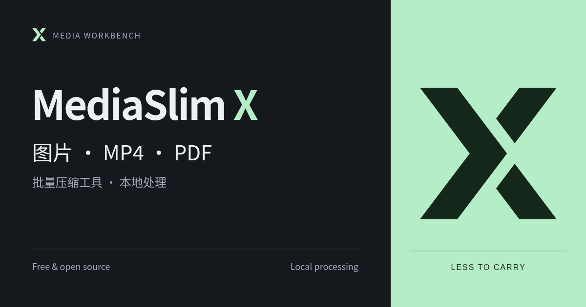
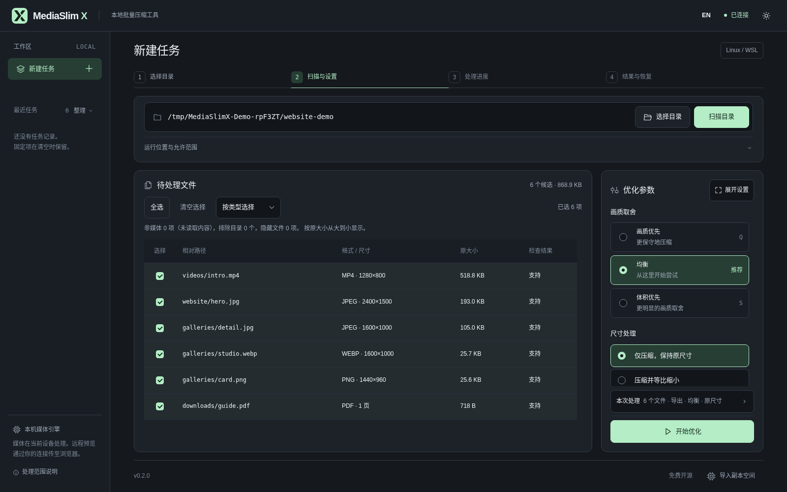
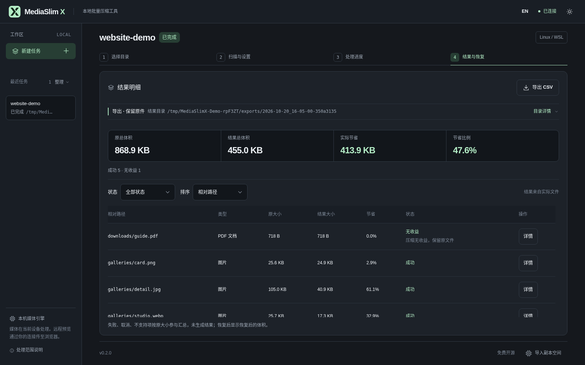

# MediaSlim X

简体中文 | [English](README.en.md)



MediaSlim X 是一个免费开源的本地批量压缩工具。扫描文件夹，选择要处理的图片、MP4 或 PDF，查看每个文件的实际结果。默认导出到新目录，保留原件、文件名和相对目录结构。

**当前只发布源码。** Windows 独立窗口和 Linux/WSL 网页版均可从源码运行，但尚无免安装的 Windows 便携包或其他二进制下载。GitHub 的“Download ZIP”是源码，需要按下文准备运行环境。便携包仍待依赖许可材料与干净 Windows 验收。

## 能做什么

- 扫描运行设备上的目录，按文件类型或逐项选择；也可把文件拖入工作台。Windows 独立窗口支持拖入单个本机文件夹直接扫描。
- 提供画质优先、均衡、体积优先三种预设。图片和受支持的 MP4 可选择最大宽高，**按比例缩小**；默认保持原尺寸。PDF 不改变页面尺寸或图片画质。
- 默认另存结果并保留原件。需要更新原目录时，可明确选择“备份后覆盖”；无备份直接覆盖需要额外确认，且不支持 PDF。
- 显示真实进度、无收益和跳过原因；保留任务历史，支持结果预览、CSV 报告和有备份文件的冲突检查恢复。节省量以实际结果为准，不承诺固定比例。



## 支持范围

| 类型 | 当前处理范围 |
| --- | --- |
| 图片 | JPG/JPEG、PNG、静态 WebP；动图及部分特殊色彩格式会跳过。 |
| 视频 | 普通 H.264、8 位 SDR `yuv420p` MP4，至多一条 AAC 音轨；需要 FFmpeg 与 ffprobe。HDR、旋转、字幕和复杂流等会跳过。 |
| PDF | **可选安装** pikepdf 后处理符合条件的非加密静态 PDF；仅优化结构与可压缩数据，不调整页尺寸。加密、签名、表单、批注等不支持。 |

完整边界与逐项原因见[功能规格](docs/v1-spec.md)。图片和视频可能使用有损压缩；不适合的文件会保留或跳过，不会把失败当作成功。

## 从源码运行

### Windows：独立窗口

1. 安装 **Python 3.10+**（含 Tcl/Tk）、**Microsoft WebView2 Evergreen Runtime**；首次构建窗口组件还需要 Windows .NET Framework 的 C# 编译器。处理 MP4 另需把 Windows 版 FFmpeg、ffprobe 放入 `PATH`。
2. 克隆仓库或下载源码 ZIP 并完整解压。
3. 在资源管理器中双击项目根目录的 **`Start-MediaSlimX.vbs`**。首次启动会建立 Windows 专用虚拟环境并安装 Python 依赖，准备窗口组件时可能联网获取 WebView2 SDK；以后可直接打开。准备失败时运行 **`Start-MediaSlimX.cmd`** 查看错误。

若只想用浏览器界面，可运行 **`Start-MediaSlimX-Browser.cmd`**。它与独立窗口共用处理核心，但各自保存任务记录。不要直接打开 `mediaslimx/static/index.html`：界面需要本机服务。

### Linux / WSL：浏览器界面

需要 **Python 3.10+**；处理 MP4 时安装本平台的 FFmpeg、ffprobe。进入项目目录运行：

```bash
./start-wsl.sh
```

首次启动会建立 Linux/WSL 专用 `.venv` 并安装锁定依赖。浏览器访问终端给出的**完整本机地址**。扫描项目目录之外的媒体，可加 `--allow-root /absolute/media/path`。在服务器上保持服务只监听回环地址，通过 SSH 隧道访问，例如：

```bash
ssh -N -L 8765:127.0.0.1:8765 user@server
```

Windows 与 WSL 不共用虚拟环境、路径或任务数据；Windows 的 `D:\...` 不能直接填入 WSL 服务。

### 可选 PDF 支持

基础依赖不包含 pikepdf。先完成一次源码启动，再在**正在使用的平台环境**中安装并重启工具：

```bash
# Linux / WSL
.venv/bin/python -m pip install -r requirements-pdf.txt
```

Windows 在项目目录运行：

```powershell
.\.venv-win\Scripts\python.exe -m pip install -r requirements-pdf.txt
```

缺少 PDF 依赖时，图片和视频仍可使用，PDF 会显示可操作的跳过原因。

## 基本流程与数据边界

1. 选择或扫描目录，检查候选文件并勾选；扫描本身不会开始压缩。
2. 选择预设、可选尺寸和输出方式，确认原件、结果、备份分别放在哪里，再开始处理。
3. 在结果页查看逐文件状态、预览与报告；有备份时可尝试恢复。处理后原文件若被修改，恢复会跳过冲突。



目录扫描只读取所选范围内的候选媒体，不跟随符号链接，并跳过隐藏、依赖、输出及备份目录。浏览器拖入文件或文件夹会把**副本传到当前连接的 MediaSlim X 服务**，因此这类导入只允许导出；连接远程服务时，副本会传到那台服务器。浏览器导入限每批 200 个媒体文件、2 GiB，大批量请扫描运行设备上的目录。

工具不把媒体上传第三方，也不接入账号、遥测或外部 CDN；远程预览仍会经由你建立的连接传到浏览器。默认只监听 `127.0.0.1`，不要直接暴露到公网。详情见[隐私与安全](docs/privacy-security.md)。

## 验证、文档与许可

Windows 源码窗口及 WSL/Linux 核心已用合成素材验证；独立 Linux 服务器、macOS 与实体手机尚未完整验证。现有演示数字只来自合成素材，不代表实际网站收益。详细状态见[平台状态](docs/platforms.md)和[发布指南](docs/release-guide.md)。

运行 Python 测试：

```bash
.venv/bin/python -m unittest discover -s tests
```

Windows 使用 `.venv-win\Scripts\python.exe -m unittest discover -s tests`。项目采用 [MIT License](LICENSE)；核心功能免费。问题反馈请勿附上含令牌、私人路径或敏感媒体的原始日志与截图。
