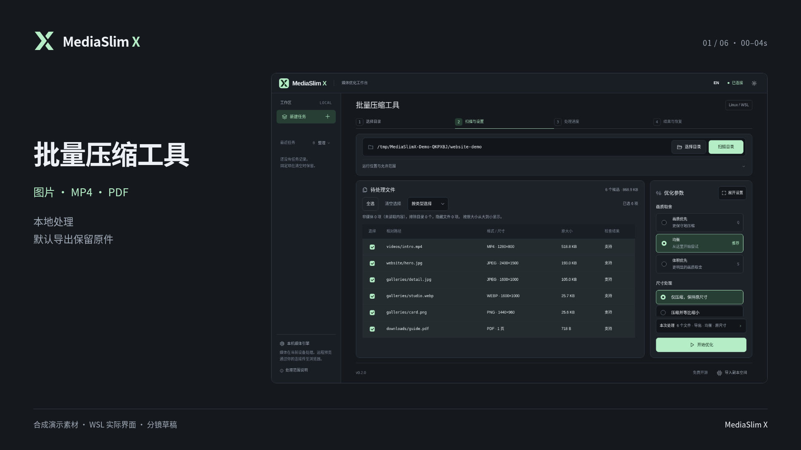
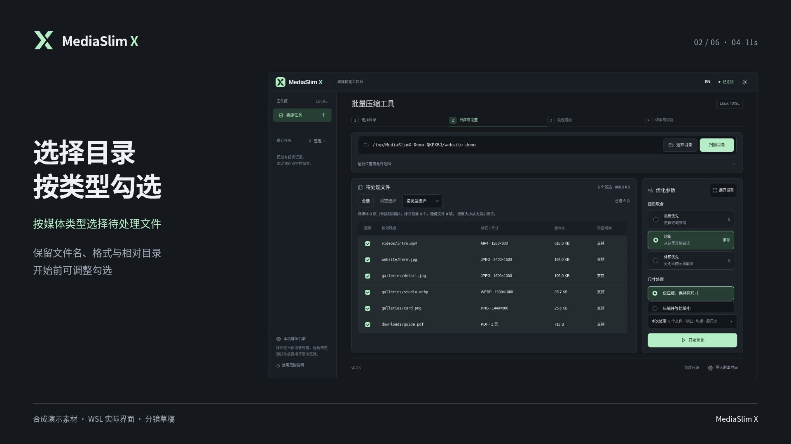
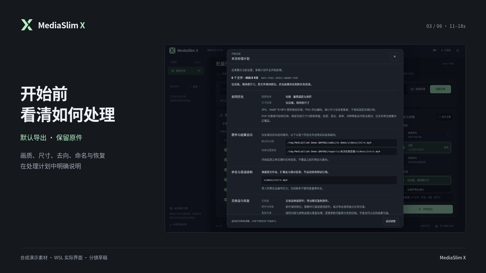
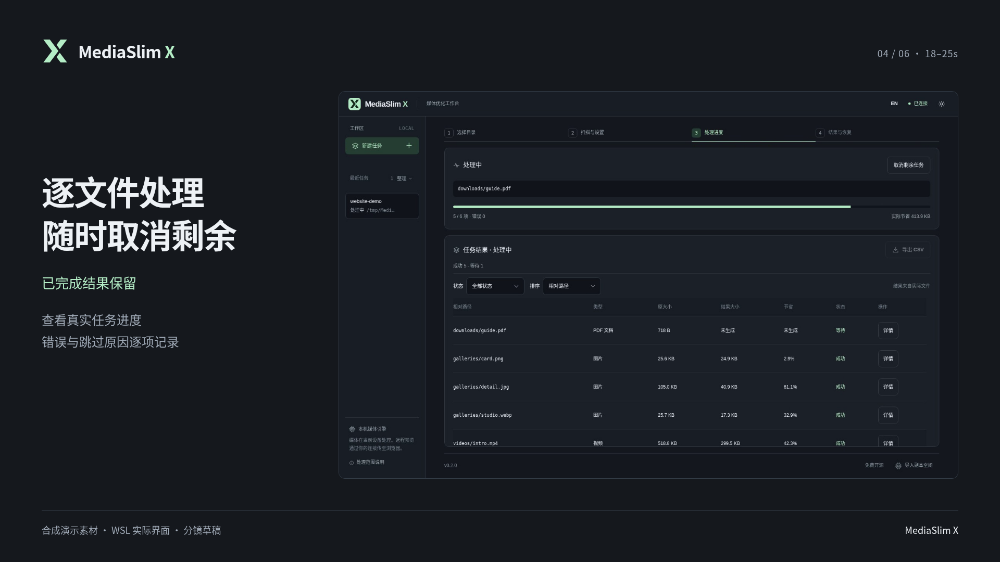
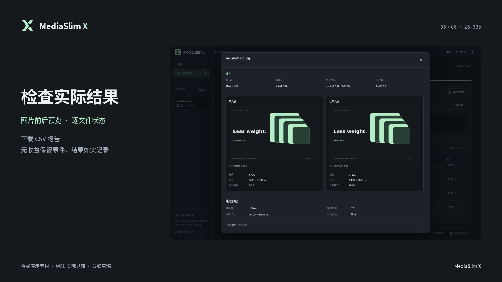
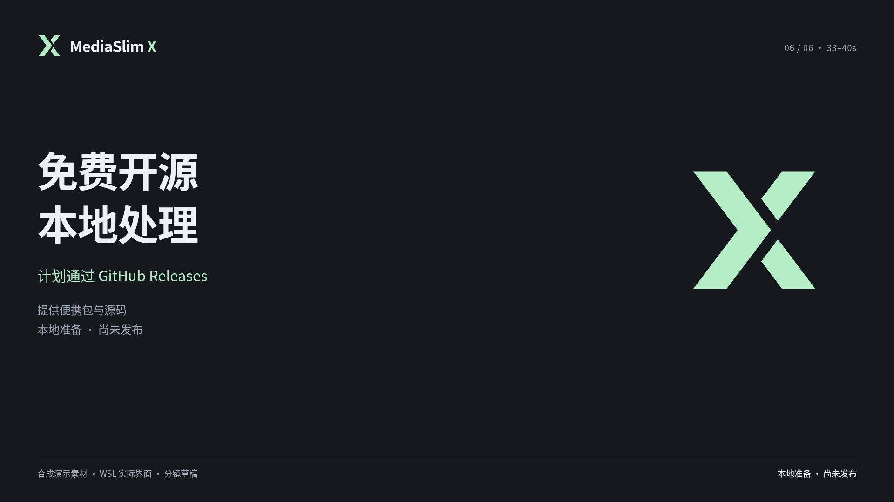

# MediaSlim X · 分镜预览

- 对应脚本：[video-spec.md](video-spec.md)
- 确认状态：**六镜已认可，本地初剪已完成，尚未发布**。2026-10-17，用户在合成确认问题中回复“我感觉分镜没问题”，LOGO 对齐延后；按本方案制作，不再次确认相同六镜。
- 说明：每张图是该镜头的静态构图；实际操作与节奏见本机忽略目录 `.mediaslimx/showcase/demo-first-cut-tx-x-solid-20261019/` 内的 `demo.zh-CN.mp4` 与 `manifest.json`。使用2026-10-19当前界面、TX 原向 X 和独立合成素材重新录制；视频为1920×1080、30fps、H.264、无音轨，已做逐镜检查与Chrome实际播放，仍是本地候选。源码克隆不附带视频。

## 整体预览

- 沿用 [DESIGN.md](DESIGN.md) 的石墨与薄荷配色、系统字体、清楚边界；短句与真实界面分区。
- 主线为“选择 → 事前计划 → 处理 → 检查”，不拿未经实测的网站收益做标题。
- 六张关键帧在 `assets/launch/preview-frames/`；本机 `assets/launch/review.html` 可浏览封面、分镜和原始操作片段。该审阅页引用被忽略的视频，仅在本地保留，不纳入公开源码。
- 已明确的制作范围：40 秒无声字幕六镜，现已统一使用 TX 原向 X。空的 Public 仓库为 `tigerx-dev/mediaslimx`；作者个人站与真实 Release 下载地址未定，不放假链接。具体公开视频平台未指定。Windows 独立窗口已有源码实现，本片展示 WSL 网页视口，不添加假窗口外框。

## 分镜预览表

| Scene | 时间 | 关键帧预览 | 简单介绍 | 预览图计划 | 动态效果计划 | 风险 / 说明 | 用户意见 |
| --- | --- | --- | --- | --- | --- | --- | --- |
| 01 | 0.0–4.0s |  | 认识产品与支持范围 | TX 原向 X、短标题、完整真实工作台 | 先标题，再显现实际界面 | 与启动封面和工作台一致 | 六镜方案已认可 |
| 02 | 4.0–11.0s |  | 目录扫描与选择 | 工作台全貌，字幕与截图分区 | 真实扫描到按 JPG 勾选，再选择本次文件 | 原片是合成素材，不是真实网站 | 六镜方案已认可 |
| 03 | 11.0–18.0s |  | 看清处理方式和原件去向 | 真实计划层与“默认导出，保留原件” | 展示预设后打开计划，依次说明尺寸与输出 | 原片 11.8 秒实际计划层 | 六镜方案已认可 |
| 04 | 18.0–25.0s |  | 实际处理与取消语义 | 真实进度状态，字幕在截图外 | 实际处理完成后说明保留规则，不拉长进度 | 原片 17.5 秒，未点击取消，不伪造取消操作 | 六镜方案已认可 |
| 05 | 25.0–33.0s |  | 结果检查与报告 | 实际前后对比或结果列表，说明合成素材范围 | 结果、图片对照、实际 CSV 下载依次出现 | 不把本例收益推广到网站；PDF 无收益照实显示 | 六镜方案已认可 |
| 06 | 33.0–40.0s |  | 开源与后续获取 | 品牌、GitHub Releases 计划、尚未发布 | 两步显现，末镜淡出 | 发布前需要替换真实版本与获取地址 | 六镜方案已认可 |

## 原始素材与验证

本机忽略目录中的 33.12 秒原始 WebM 来自独立 WSL/Linux 服务。六项自制素材，五成功、一项 PDF 无收益；所有原件 SHA-256 保持，页面错误与第三方请求均为零。数字与逐文件参数见 [实测 manifest](assets/showcase/manifest.json)，复现见 [说明](assets/showcase/README.md)。这不是实体手机或干净 Windows 验收。

## 确认记录与制作边界

- 2026-10-17，用户在“是否按这版 40 秒、16:9、无声字幕方案合成演示视频”的确认问题中回复“我感觉分镜没问题”，并表示 LOGO 后续再对齐。本次六镜与规格确认后，已完成本地初剪；只在真实计划层及已完成结果各停留1.2秒，进行中进度保持原速。
- LOGO 已按用户后续决定更新为 TX 原向 X；作者个人站地址尚未确定，不添加虚构链接。项目可作为个人案例，用途与受众建议见脚本；具体公开平台未指定。
- 后续若新增旁白、另一比例或不同总体方向，更新脚本和受影响关键帧；当前六镜无需重复审批。
- 2026-10-19 使用更新后的 TX X 和产品文案重录合成素材、重绘六镜、重渲 40 秒中文初剪。第 06 镜保留“尚未发布”直至源码和便携包一起上线；届时仅改获取文案与片尾画面，再验整片播放。备份恢复、异常续做、Windows 独立窗口不硬塞进这段 40 秒概览，由 README、截图和单独验证说明承载。
- 开发环境采用 video-pre-launch-check-officer 技能；其原文要求“用户明确批准前，不引导 /hyperframes，不启动生成视频”。本轮录屏、封面、逐镜静帧及文案预审已完成，用户已认可方案，该预审不再构成合成阻塞。技能文件不随开源仓库分发。
